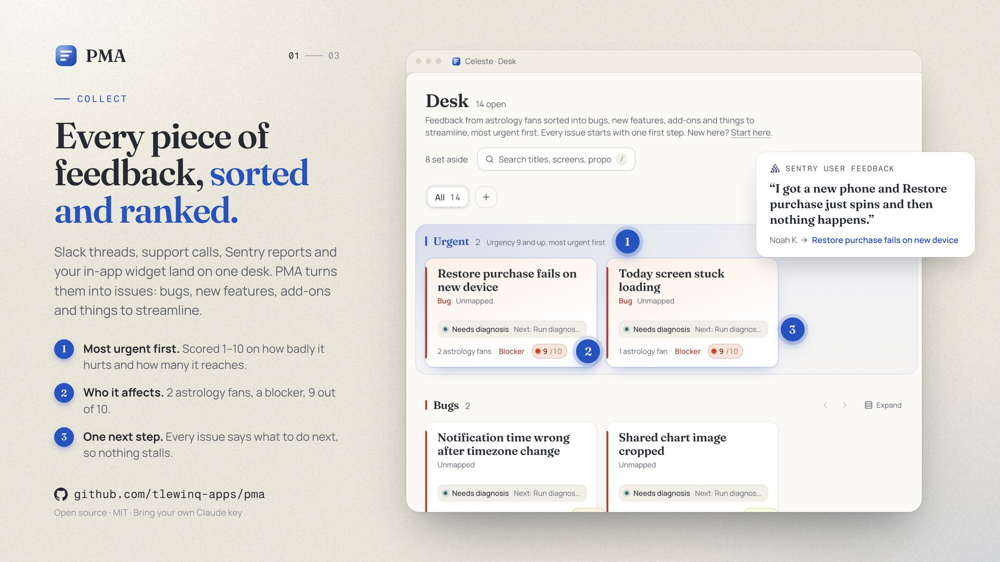
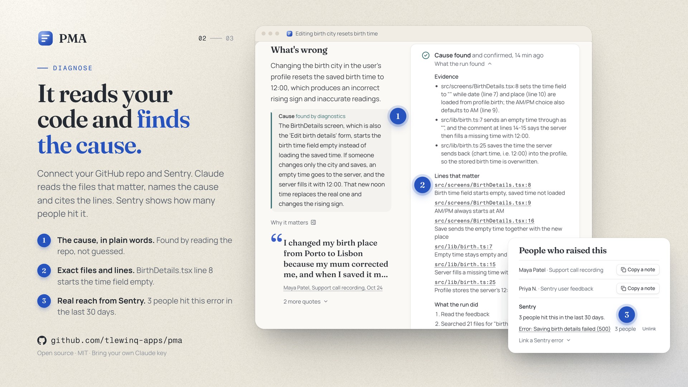
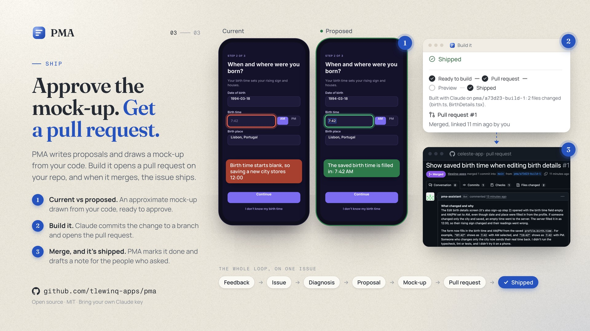

# PMA

**PMA, the Product Manager Assistant: feedback in, shipped fixes out.**

PMA reads what your users tell you (calls, Slack threads, files, recordings, an in-app widget) and turns it into issues a team can ship. Claude splits the feedback into pieces, groups them into issues (bug, new feature, add-on, streamline) and scores how urgent each one is. From an issue, a PM runs its first step (diagnose a bug, scope a feature), picks a proposal and gets a mock-up drawn over the product's real screens. After approving it, the PM presses **Build it**: Claude writes the change and PMA opens the pull request in your GitHub repository. The issue ships when that pull request merges.

Every company brings its own Claude API key. PMA never spends anyone else's.





## Run it yourself

You need Node 22.18 or later (`nvm use` reads `.nvmrc`), a free [Supabase](https://supabase.com) project and a GitHub account. The demo data loads without a Claude key, so you can look around first.

1. **Install.**
   ```bash
   git clone https://github.com/tlewinq-apps/pma.git
   cd pma
   npm install
   cp .env.example .env.local
   ```
2. **Create a Supabase project** (any region; note the database password). From Project Settings > API Keys > Legacy API keys, copy the project URL, the `anon` key and the `service_role` key into `.env.local`, with `SUPABASE_DB_PASSWORD` and the project's ref as `PMA_DEV_SUPABASE_REF`.
3. **Make a GitHub OAuth App for sign-in** at github.com/settings/developers. Its callback URL is `<your Supabase URL>/auth/v1/callback`. Put its client id and a new client secret in `.env.local` as `SUPABASE_AUTH_EXTERNAL_GITHUB_CLIENT_ID` and `SUPABASE_AUTH_EXTERNAL_GITHUB_SECRET`.
4. **Create the database and turn on GitHub sign-in.** The first commands apply every file in `supabase/migrations`; the last sends `supabase/config.toml`'s auth settings (GitHub sign-in, the localhost redirect) to the project.
   ```bash
   npx supabase login
   npx supabase link --project-ref <your project ref>
   npx supabase db push
   npm run supabase:config-push
   ```
5. **Start it, sign in, and load the demo.**
   ```bash
   npm run dev
   ```
   Open http://localhost:3000 and sign in with GitHub. Then make yourself the owner of the demo company and fill its sample app with a ready-made set of feedback, issues and proposals (no Claude calls):
   ```bash
   npm run create-user -- <your GitHub email> --owner
   npm run seed:snapshot
   ```
   The Desk is at http://localhost:3000/demo/celeste.

To put a copy online for your team (Vercel, a production Supabase project, the GitHub App, Slack), see [docs/self-hosting.md](docs/self-hosting.md).

### Things to try

- **Desk**: issues in rails by type, with the urgent ones first. Open one for its workspace.
- **An issue**: run its first step, pick or write a proposal, press **Mock it up** (needs a Claude key), then approve it. **Create full flow** plans the whole journey.
- **Add feedback**: paste a transcript, drop files, or transcribe one of the bundled sample recordings. New issues appear on the Desk a minute or two later.
- **Set up your own company**: on `/no-company`, then **Start here** walks through adding your Claude key and connecting your GitHub repository, Slack, Sentry, PostHog, Granola and Marver.

## Use PMA from Claude

PMA has an MCP server, so people can work with the backlog from Claude. A PM asks what's most urgent, what customers said about an issue and where it sits in the code, or hands Claude notes from a call to file. An engineer pulls an approved issue into Claude Code, builds it in their own checkout and runs their own tests, which **Build it** can't do; the pull request still links back to the issue and ships it when it merges.

The endpoint is `https://<your-pma>/api/mcp`, and the app's API key picks the app. Owners and admins copy the command, key included, from **Settings > Use PMA from Claude**:

```bash
claude mcp add --transport http pma https://<your-pma>/api/mcp --header "Authorization: Bearer YOUR_PMA_API_KEY"
```

| Tool | What it does |
| --- | --- |
| `list_issues` | Open issues ranked as the Desk ranks them, with type, urgency, people reached and stage. Filter by type, set a limit. |
| `get_issue` | One issue by short id or link: the problem, quotes (never emails), the finding with its file:line evidence, the proposals and the mock-up's status. |
| `add_feedback` | Queues feedback the way `POST /api/v1/feedback` does; it shows up on the Desk a minute or two later. |
| `get_build_task` | For an issue whose mock-up is approved: the same task as **Copy task for Claude Code**, ending with its `PMA: <short id>` line. Pulling it counts as the hand-off. |

The server only answers requests. Intake (Slack, Sentry, Granola, the widget, cron), the Desk, mock-ups and approvals all keep running in the app. Text that came from feedback is handed to Claude as evidence, never as instructions.

## Scripts

| Command | What it does |
| --- | --- |
| `npm run dev` | The app on http://localhost:3000 |
| `npm run seed:snapshot` | Replaces the demo app's sources, issues and screens with the pre-computed set (no API calls) |
| `npm run seed` | Runs the real pipeline over the demo sources instead (calls Claude) |
| `npm run create-user -- <email> [--owner]` | Makes sure the account exists; `--owner` also makes it the demo company's owner and a platform admin |
| `npm run github:app -- dev\|prod` | Registers the PMA GitHub App (Connect with GitHub, Build it, See it live) |
| `npm run slack:manifest` | Prints the Slack app manifest for your deployment |
| `npm test` | Unit tests (Vitest) |
| `npm run typecheck` / `npm run lint` | TypeScript and ESLint |
| `npm run e2e` | Playwright end-to-end suite against your dev project |
| `npm run eval` | Scores the extraction stage against labelled fixtures (a few Claude calls) |

The maintenance scripts refuse to run against the project named by `PMA_PROD_SUPABASE_REF`.

## How it's built

- **Next.js 16** (App Router, React 19, Turbopack) with Tailwind CSS 4. Pages live under `src/app/(app)/[org]/[app]/`: every company (`org`) has apps, and the demo is `demo/celeste`.
- **Supabase** for Postgres, auth (Sign in with GitHub), storage and row-level security; schema in `supabase/migrations`. Companies can't see inside each other, and platform admins only see counts.
- **Claude** (`claude-opus-5-5` through `@anthropic-ai/sdk`, `src/lib/llm`) for extraction, grouping, first steps, proposals, mock-ups and Build it, always on the company's own key.
- **Marver** design canvases for mock-ups: `demo/celeste-design` is the built-in one, packed into `src/lib/marver/fixture.generated.ts` by `npm run design:pack`. Apps without a canvas get mock-ups drawn from their code.

| Folder | What's there |
| --- | --- |
| `src/lib/pipeline`, `src/lib/ingest` | Feedback in: parsing, extraction, grouping, scoring |
| `src/lib/diagnosis`, `src/lib/proposals.ts`, `src/lib/drafts`, `src/lib/marver` | First steps, proposals and mock-ups |
| `src/lib/build`, `src/lib/github`, `src/lib/handoff` | Build it (Claude writes the change, the GitHub App opens the pull request), See it live, the Claude Code hand-off |
| `src/lib/mcp`, `src/app/api/mcp` | The MCP server for Claude, scoped to an app's API key |
| `src/lib/slack`, `src/lib/sentry`, `src/lib/posthog`, `src/lib/granola`, `src/lib/connections` | Connectors |
| `src/components` | UI, grouped by screen |
| `tests/unit`, `tests/rls`, `e2e` | Unit tests, row-level security tests, Playwright |

## License

[MIT](LICENSE).
